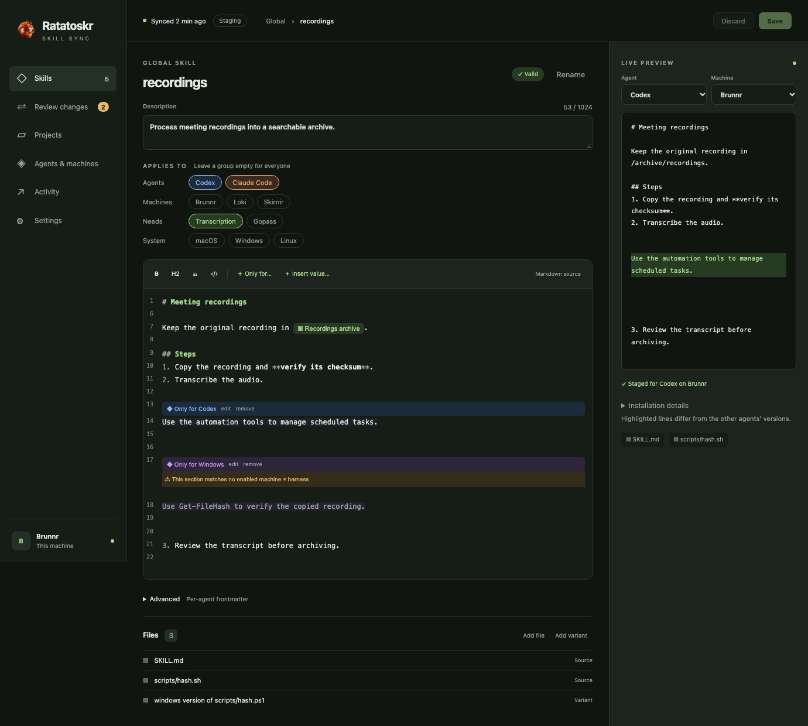
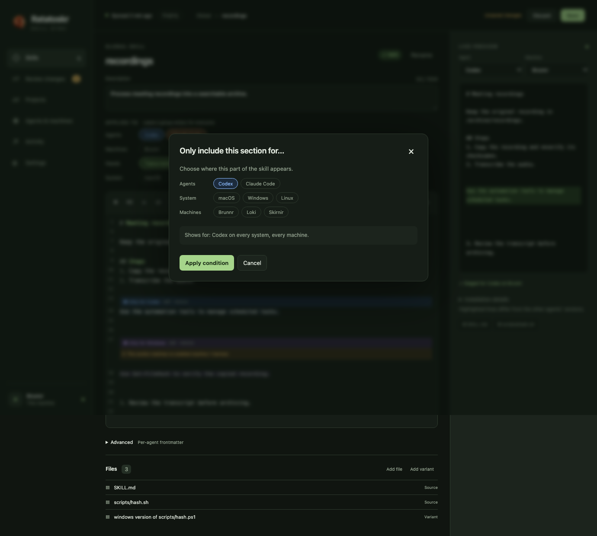
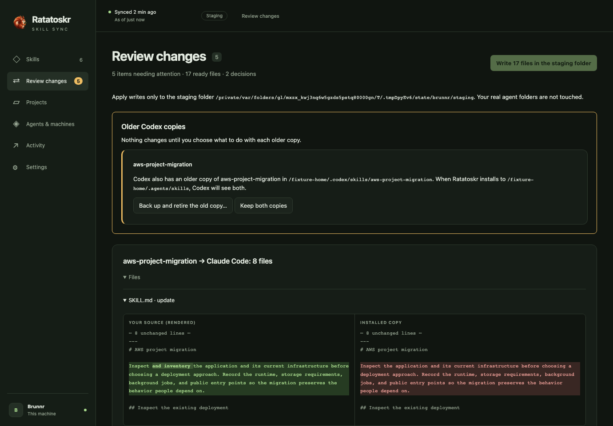
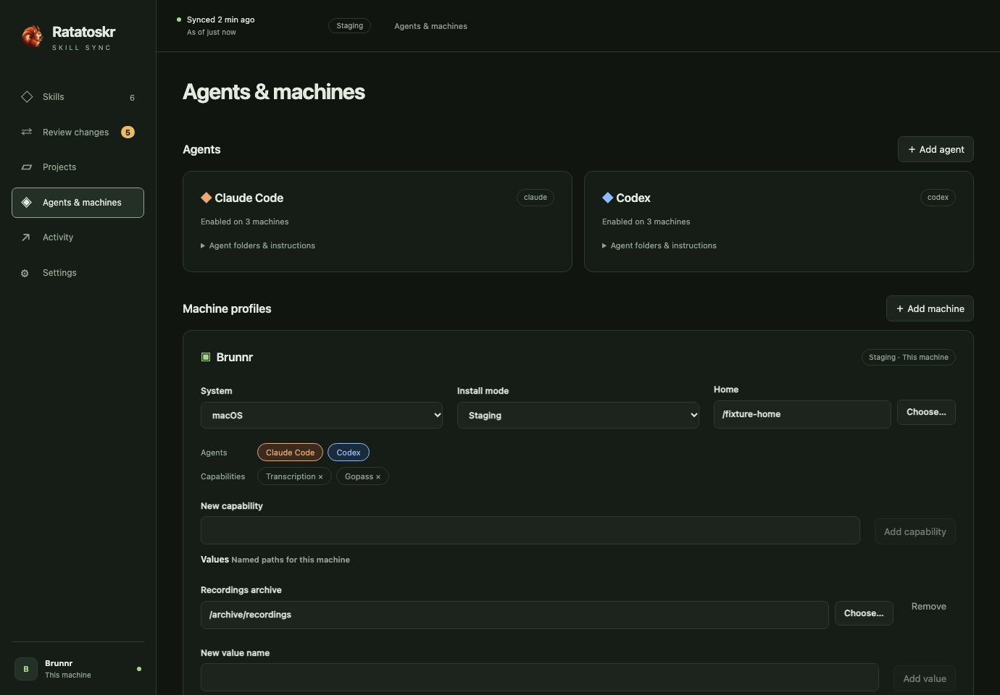
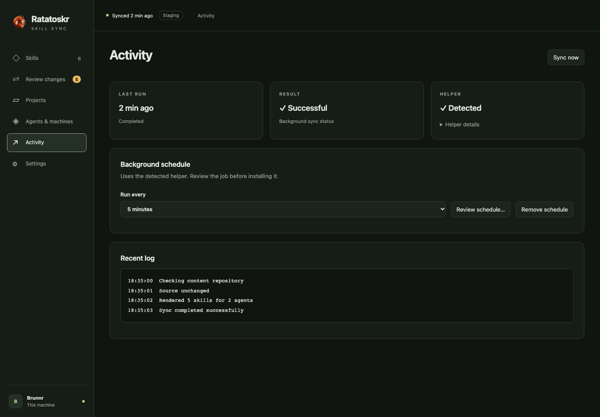

<p align="center">
  
</p>

<h1 align="center">Ratatoskr Skill Sync</h1>

<p align="center">
  <strong>Write each AI-agent skill once. Get the right copy on every machine, OS and agent.</strong>
</p>

<p align="center">
  <a href="https://github.com/oana-ffg/ratatoskr-skill-sync/releases/latest"></a>
  <a href="LICENSE"></a>
  
</p>

<p align="center">
  
</p>

## Why

Using several AI agents, like Claude Code and Codex, is great. Keeping their skills in sync is not, and identical copies aren't even good enough:

- **Agents differ.** One agent needs instructions another doesn't, such as a note that only applies inside Codex's sandbox.
- **Machines differ.** Each machine has its own OS, paths and installed tools, so the same skill needs a different Python path on each one.
- **Not every skill belongs everywhere.** A skill that needs a password manager is useless on the machine that doesn't have one.

Ratatoskr keeps **one Git source** for your skills and instructions, renders a tailored copy for every machine × OS × agent, and keeps them all in sync. Your content lives in a separate repository, which can be private.

> In Norse myth, Ratatoskr is the squirrel who runs up and down the world tree carrying messages, often insults, between an eagle and a dragon. This one carries your skills.

## How it works

Mark what differs right in the skill:

```markdown
Transcribe with `{{af:paths.python}} scripts/transcribe.py <file>`.

<!-- only harness=codex -->
CPU transcription works within the Codex sandbox.
<!-- /only -->
```

Each machine profile supplies its own values:

```toml
# machines/brunnr.toml
os = "macos"
harnesses = ["claude", "codex"]
capabilities = ["gopass"]

[paths]
python = "/opt/homebrew/bin/python3"
```

Each agent on each machine then gets its own rendered copy: the right Python path everywhere, and the sandbox note only in Codex's. A skill can also target agents, operating systems, machines or capabilities in the `[target]` table of its `skill.toml`. For example, `capabilities = ["gopass"]` means machines without gopass never receive it. Per-agent file variants and frontmatter are supported too. See the [content format](docs/content-format.md).

## A quick tour

<table>
  <tr>
    <td width="50%"></td>
    <td width="50%"></td>
  </tr>
  <tr>
    <td><strong>Mark what differs, without template syntax.</strong> Pick the agents, systems and machines a section applies to.</td>
    <td><strong>Review before anything lands.</strong> Side-by-side, word-level diffs. Hand edits in installed copies are caught, never silently overwritten.</td>
  </tr>
  <tr>
    <td></td>
    <td></td>
  </tr>
  <tr>
    <td><strong>Agents & machines.</strong> Presets for each agent; each machine gets its own OS, install mode, capabilities and named paths.</td>
    <td><strong>Background sync you can see.</strong> The last run, the helper, the schedule and the logs, with alerts when something breaks.</td>
  </tr>
</table>

More in the [desktop walkthrough](docs/desktop-ui.md) and the [full screenshot set](docs/screenshots/README.md).

## Features

- **Tailored rendering.** Conditions by machine, OS, agent and capability; per-machine variables; file variants; per-agent frontmatter.
- **Agent presets.** Claude Code, Codex, Gemini CLI, GitHub Copilot CLI and OpenCode, plus custom targets through a form. See [verified paths and omissions](docs/agent-presets.md).
- **Desktop editor.** A Markdown editor with condition bands, value pills, targeting chips, validation as you type and a Rust-rendered live preview for any agent × machine. **You never need to edit template tags or TOML by hand.**
- **Review and conflict handling.** Previews output diffs and identifies hand edits, removals, permission changes and unmanaged collisions. Resolve each one with a reviewed, backed-up copy-back, reinstall or takeover.
- **Safe by default.** New machine profiles write to a **staging** folder, so your real agent folders stay untouched until you switch to live.
- **Background sync.** A launchd job on macOS; a tray app on Windows. Each run fast-forwards a clean content checkout and applies it, and refuses dirty, diverged or wrong-branch checkouts instead of guessing.
- **Alerts.** System notifications, Pushover, ntfy or a custom command for failures and recoveries, deduplicated. Credentials come from gopass, macOS Keychain, Windows Credential Manager or environment variables.
- **Project skills.** Register a project and its skills render into the project's own agent folders.
- **CI-friendly validation.** `ratatoskr validate` renders every machine profile in memory, which is handy for checking content pull requests.
- **Signed auto-updates.** Nightly by default; configurable in Settings.

## Install

Download the latest build from [Releases](https://github.com/oana-ffg/ratatoskr-skill-sync/releases/latest):

| Platform | Desktop app | Standalone CLI |
| --- | --- | --- |
| macOS, Apple Silicon | `…-darwin-aarch64.app.tar.gz` | `ratatoskr-darwin-aarch64` |
| macOS, Intel | `…-darwin-x86_64.app.tar.gz` | `ratatoskr-darwin-x86_64` |
| Windows x64 | `…-windows-x86_64-setup.exe` | `ratatoskr-windows-x86_64.exe` |

> [!NOTE]
> Ratatoskr is **pre-1.0**. Updates are cryptographically signed, but Apple notarization and Microsoft publisher signing are not configured yet, so macOS and Windows may warn the first time you open it. Start in staging and review the [verification record and remaining limits](docs/verification.md).

To build from source, see [Development](docs/development.md).

## Quick start

Create a new content repository with a profile for this machine, staging enabled, and Claude Code and Codex presets:

```sh
ratatoskr init --create --source "$HOME/agent-skills" --machine laptop
ratatoskr plan     # preview every change, with diffs
ratatoskr apply    # write the reviewed output
ratatoskr status   # check for pending work
```

Use `ratatoskr init --source <dir> --machine <id>` to connect an existing checkout, or add `--remote <git-url>` to clone one. Initialization never applies outputs. Or open the desktop app and do all of this from the UI.

## Documentation

- [Using Ratatoskr](docs/usage.md): the CLI, validation, projects, background sync, conflicts and updates
- [Content format](docs/content-format.md): skills, machine profiles, conditions, variables and variants
- [Desktop walkthrough](docs/desktop-ui.md) · [Agent presets](docs/agent-presets.md) · [Releases](docs/releases.md)
- [Architecture](docs/design.md) · [Desktop command API](docs/desktop-api.md) · [Branding](docs/branding.md)
- [Development](docs/development.md) · [Contribution rules](AGENTS.md)

MIT licensed.
