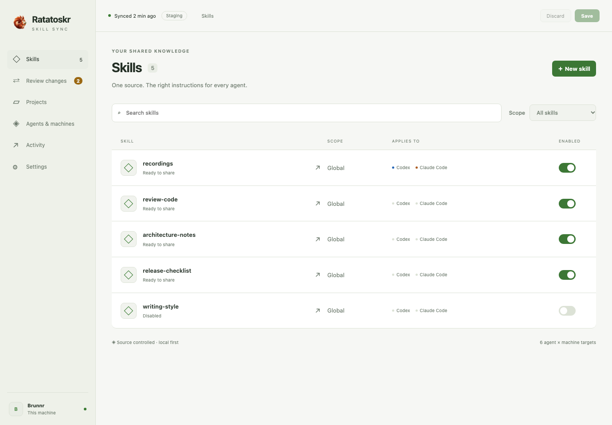
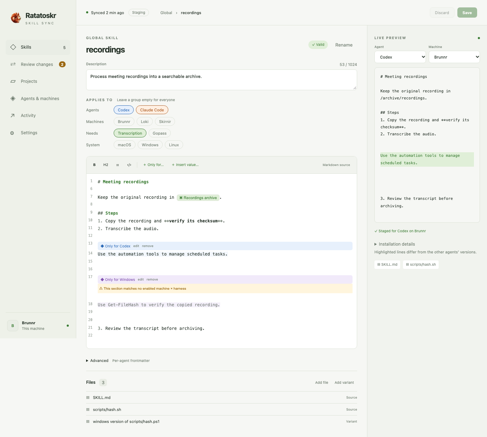
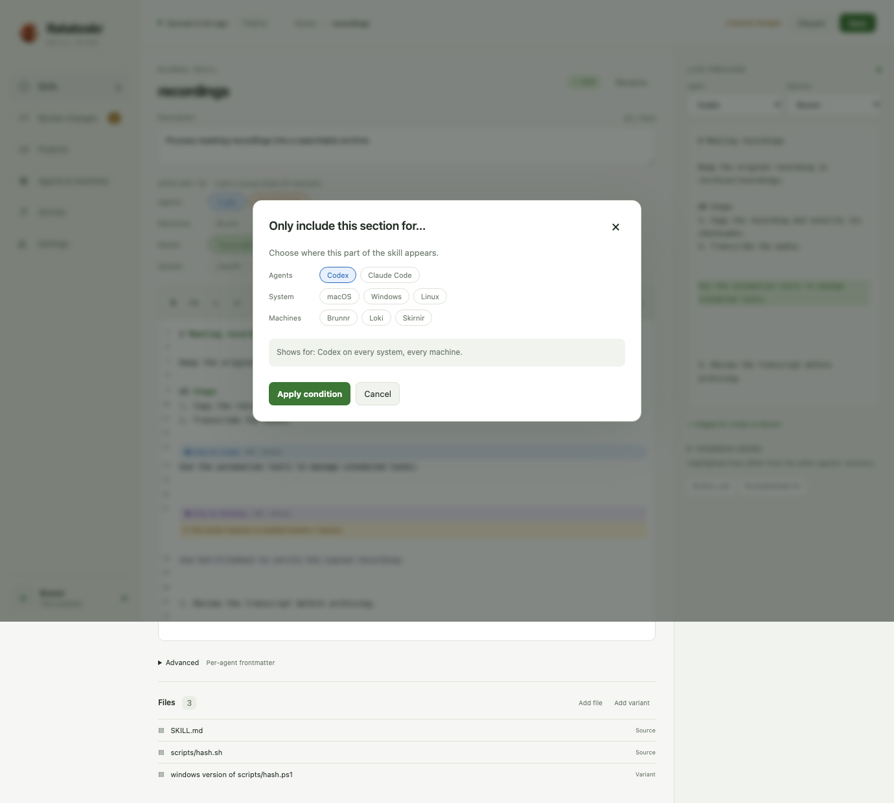
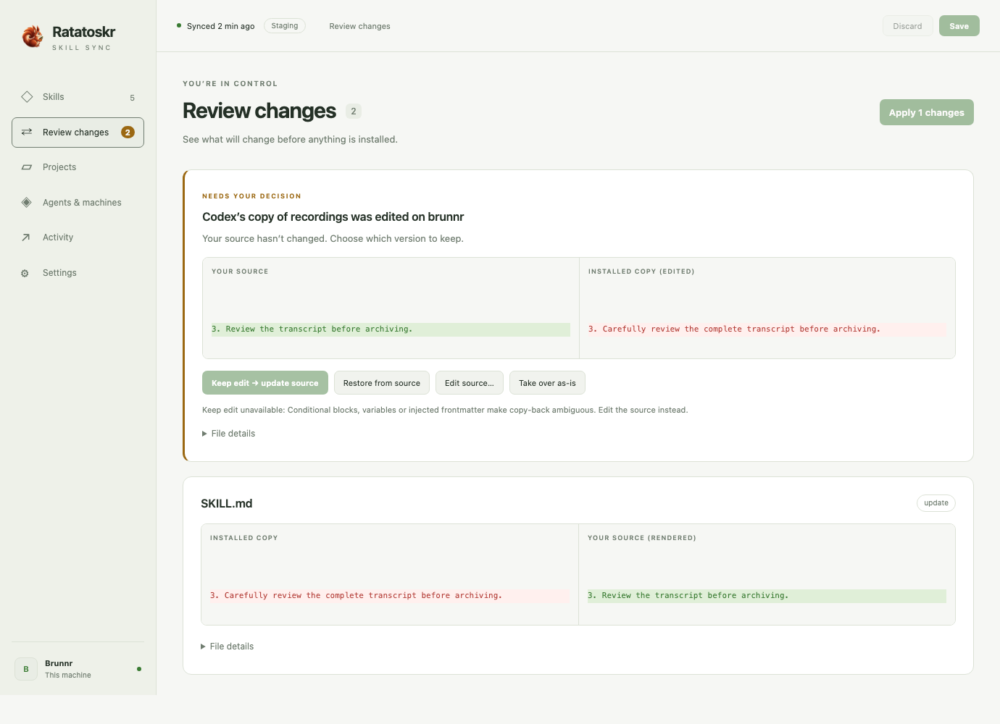
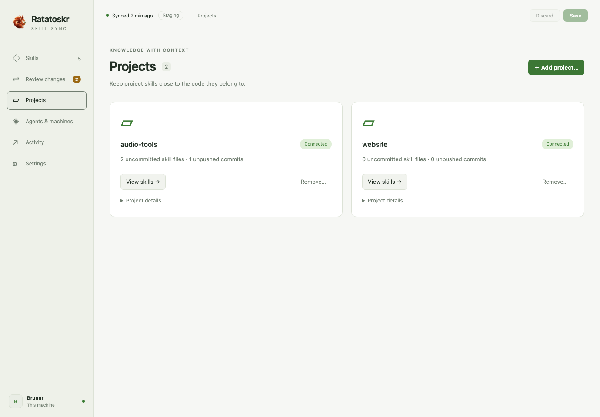
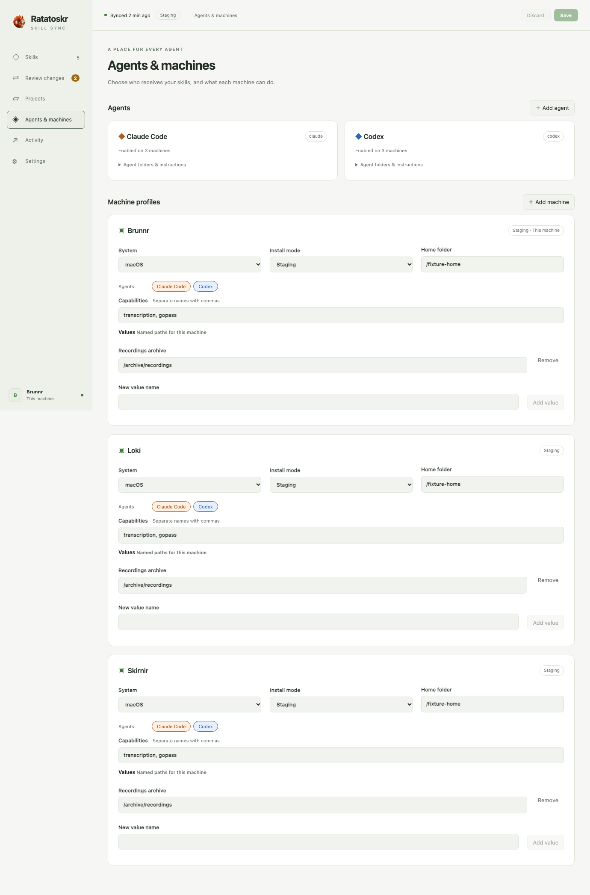
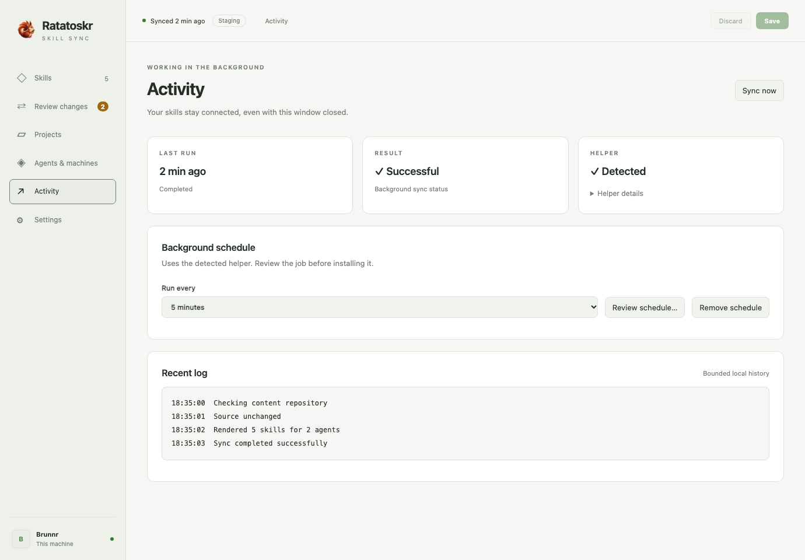
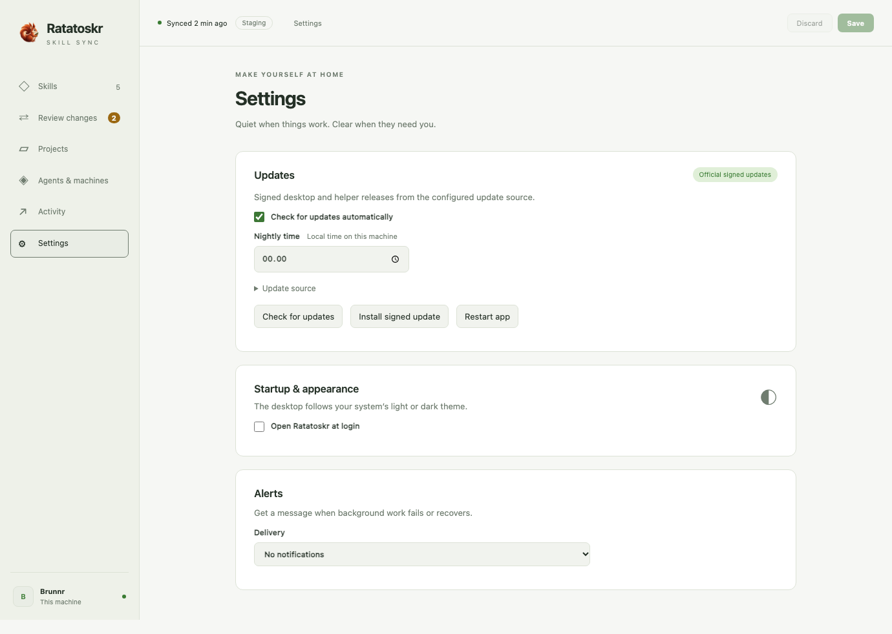

# Desktop screenshots

Generated by `cd desktop && npm run test:screenshots` using disposable Rust fixtures and mocked Tauri IPC. Both themes follow the browser OS preference.

## Skills

## Skill editor

## Only-for picker

## Review changes

## Projects

## Agents & machines

## Activity

## Settings

