# Desktop screenshots

Generated by `cd desktop && npm run test:screenshots` using disposable Rust fixtures and mocked Tauri IPC. The app is dark-only. Fourteen screenshots cover every main screen, the Only-for picker, realistic long frontmatter, source mode, and ntfy settings; longer panes use a taller viewport so the full shell and form remain visible. Review changes and Agents & machines also get a window-sized overview, used in the project README.

## Skills

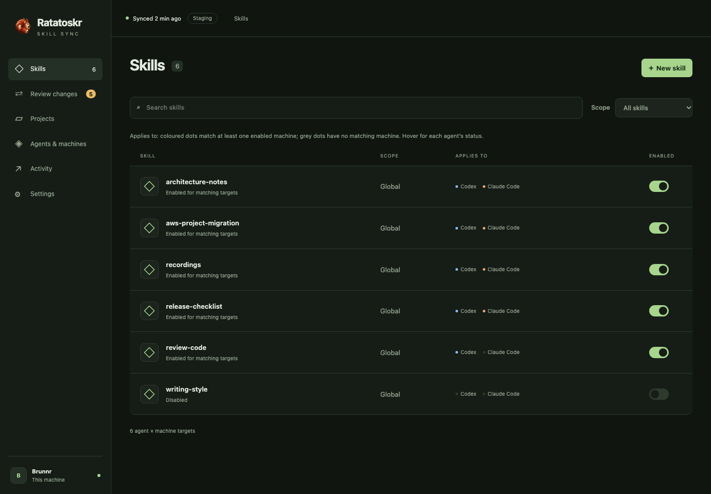

## Skill editor

## Only-for picker

## Review changes

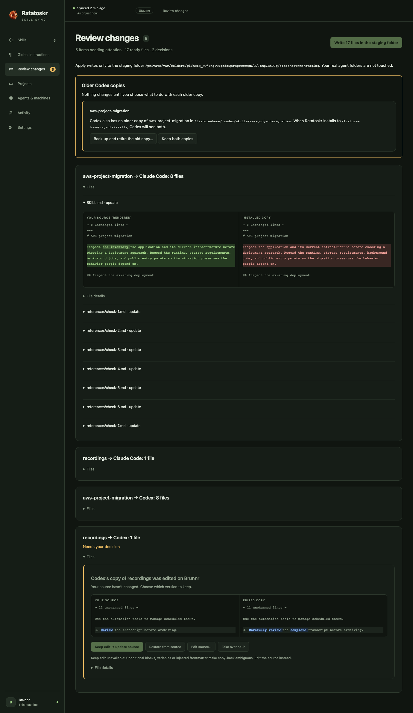

## Projects

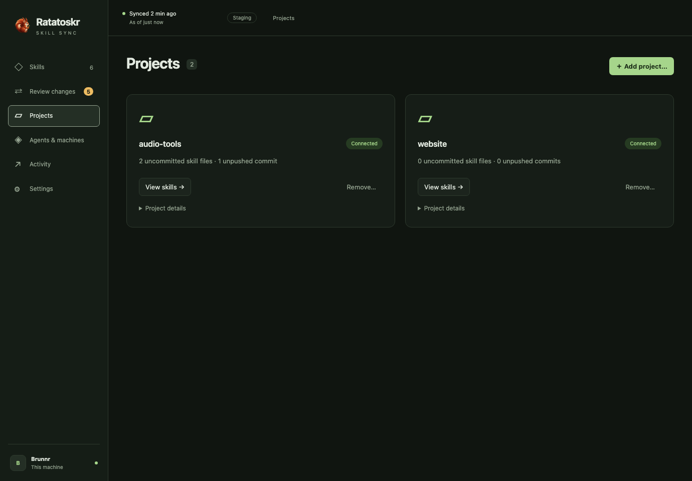

## Agents & machines

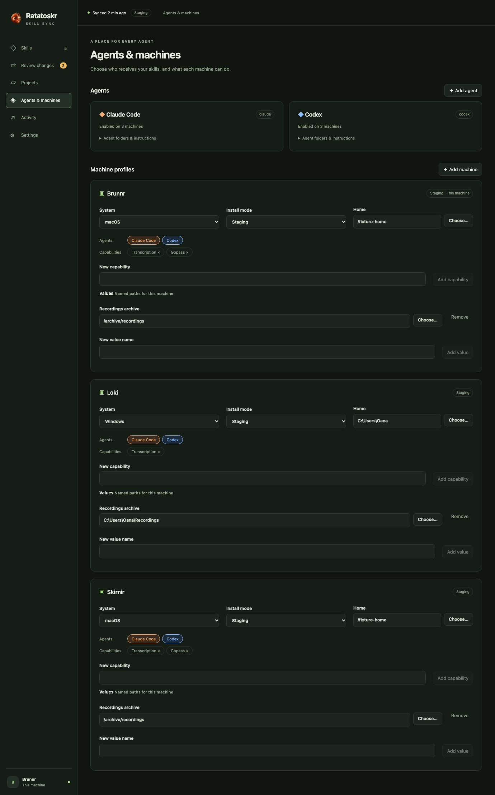

## Activity

## Settings

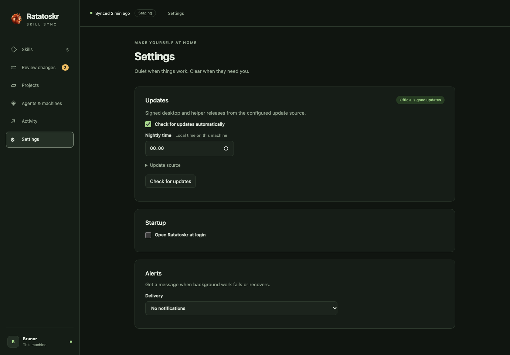

## Realistic long-frontmatter skill

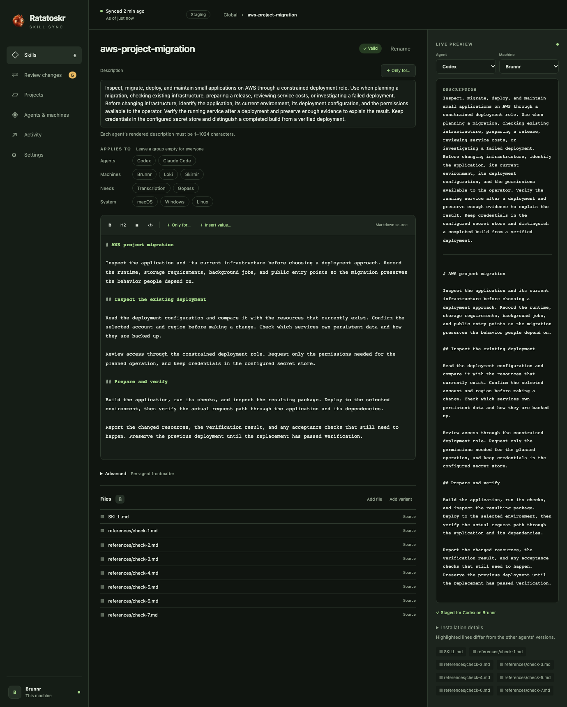

## Markdown source mode

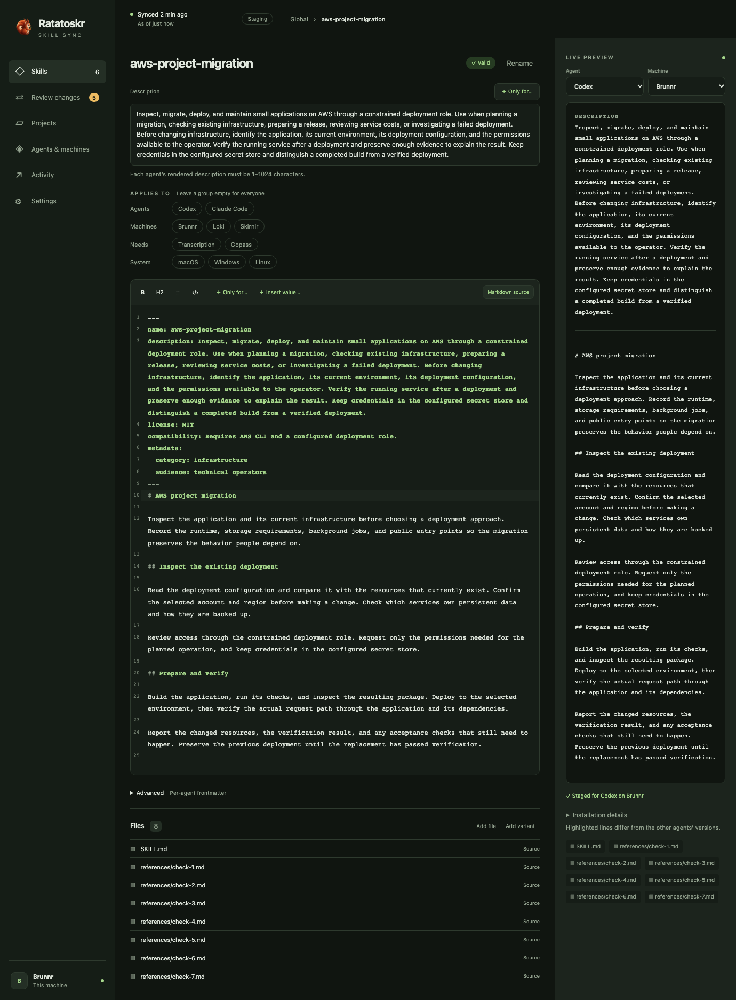

## ntfy settings

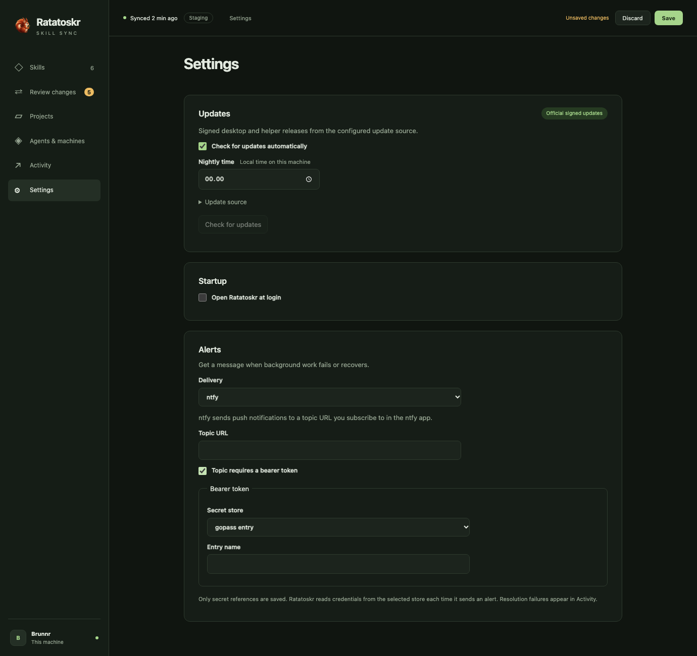

## Windows tray settings

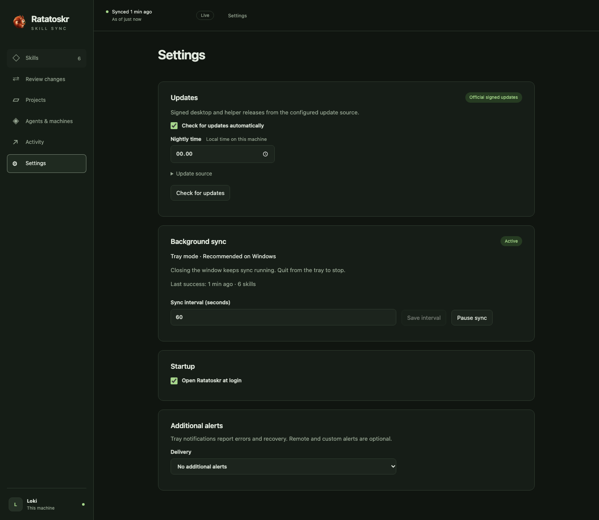

## Refresh paused for unsaved edits

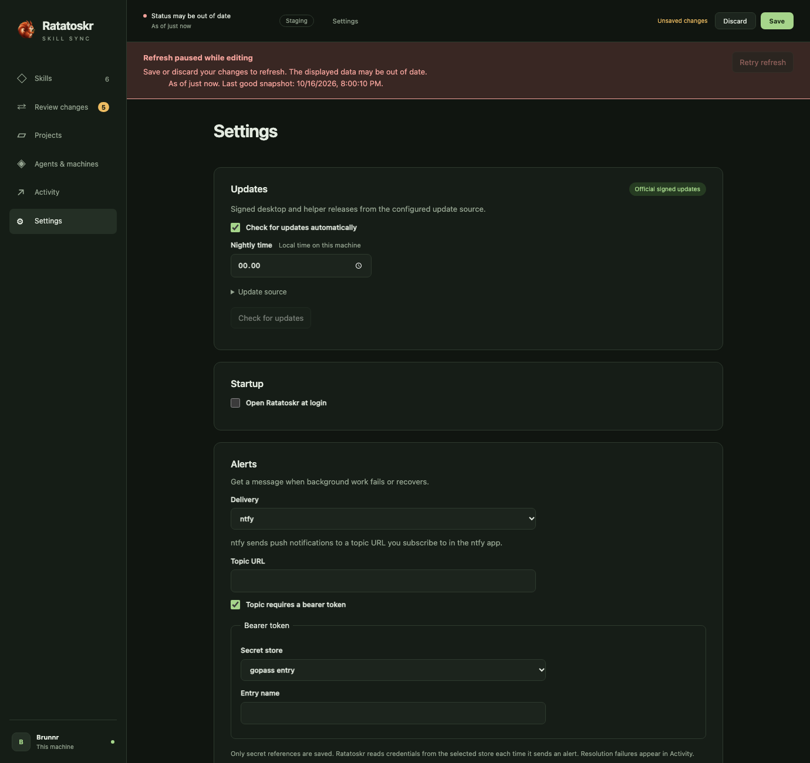

## Refresh failure with last good snapshot time

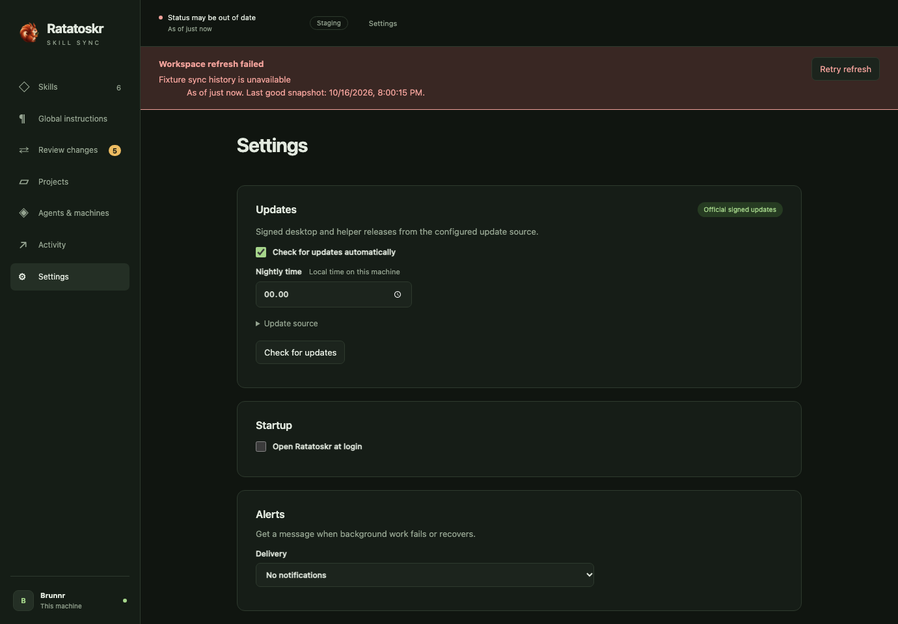
